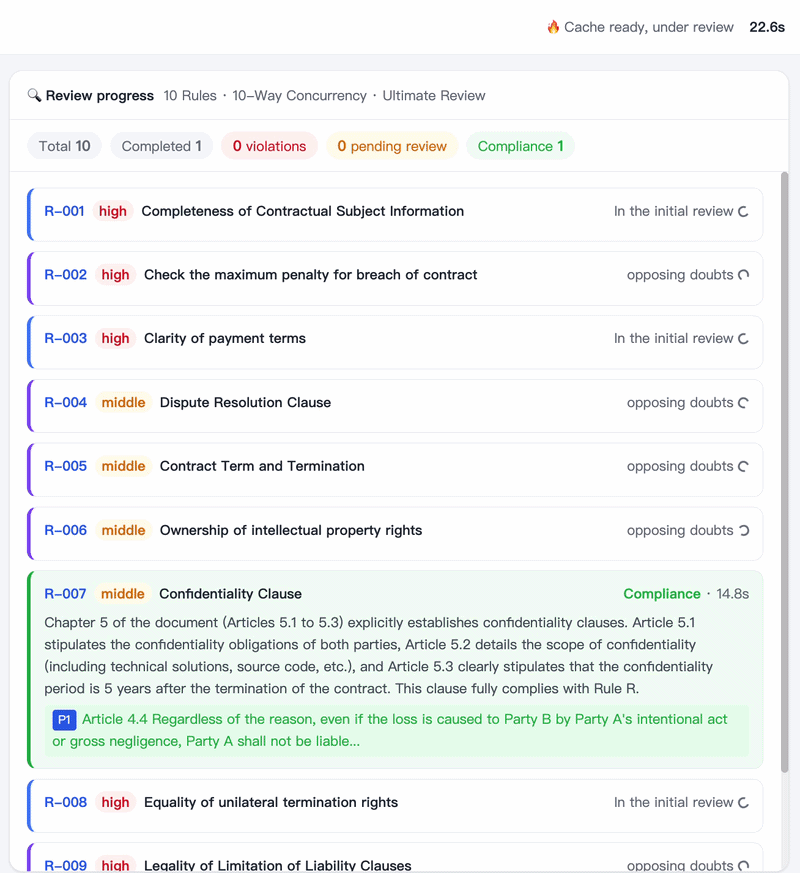
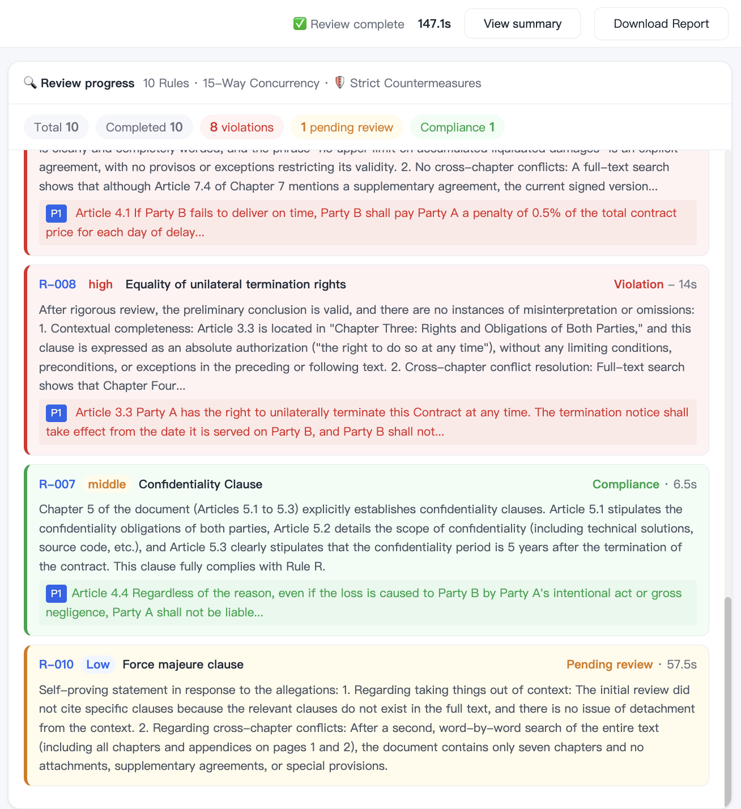
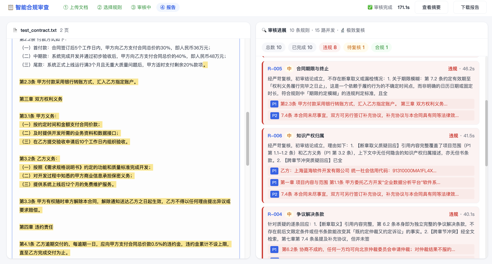
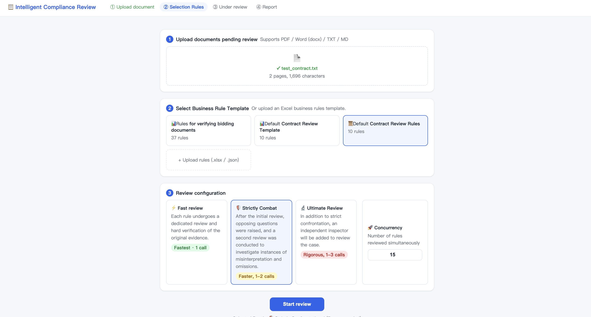
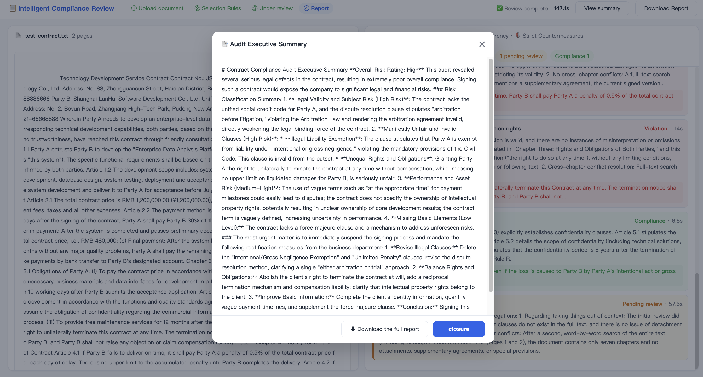
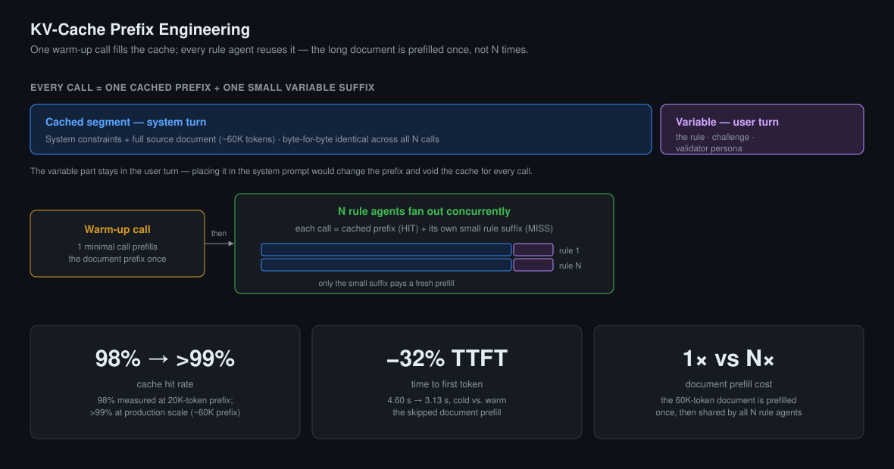
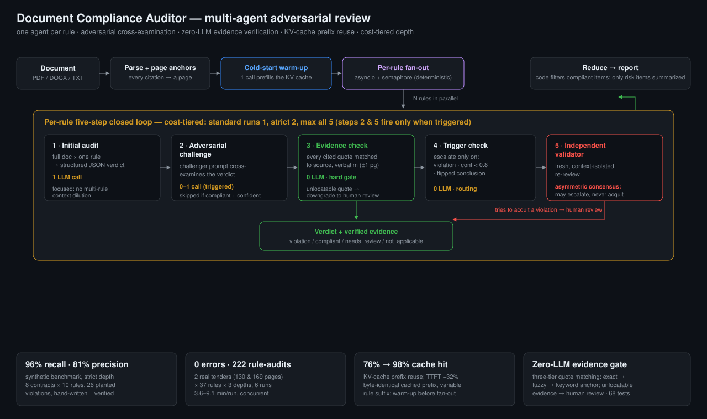
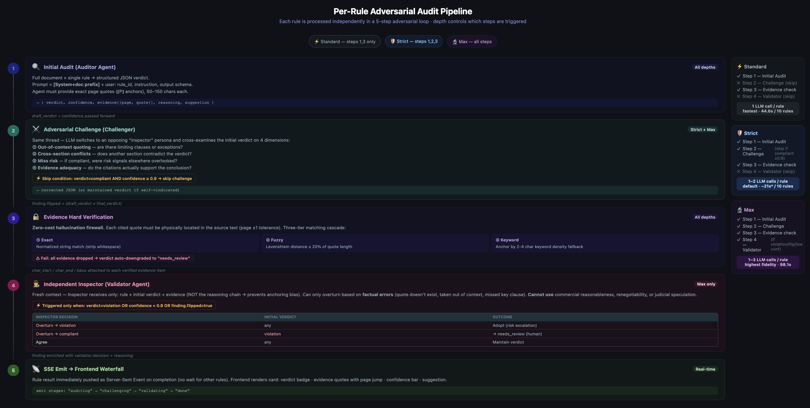

# Document Compliance Auditor

An LLM-powered multi-agent system that reviews 100+ page contracts and tender
documents against configurable compliance rules, verifies every quoted piece of
evidence against the original document, and streams auditable results in real time.

> **Note:** The implementation is proprietary to New H3C Technologies; this page
> documents the system design. Metrics are from synthetic benchmarks and
> aggregate production logs; no client documents are disclosed.

## Demo



A live audit: a paginated document preview on the left with click-to-highlight
evidence, and a real-time waterfall of rule cards on the right, each advancing
through audit → challenge → validation and colored by verdict.

*Designed and implemented the complete system: the multi-agent orchestration
pipeline, deterministic evidence-verification, FastAPI backend, streaming
frontend, benchmarking framework, and evaluation suite.*

<details>
<summary>More screenshots — findings, evidence highlighting, executive summary</summary>

**Color-coded verdicts with page-anchored evidence:**


**Clicking a finding highlights the exact clause in the source document:**


**Setup — rule templates and cost-tiered review depth:**


**Auto-generated executive summary:**


</details>

## Problem

Naive LLM document review fails in two characteristic ways:

- **Attention dilution** — accuracy degrades when dozens of rules compete inside
  one prompt over a long context (the "lost in the middle" effect).
- **Hallucinated evidence** — models cite supporting quotes that read convincingly
  but do not exist in the document.

This project addresses both directly: independent, rule-specialized agents
eliminate cross-rule dilution, and deterministic evidence verification rejects any
citation that cannot be located in the source.

## Key engineering innovations

**Evidence verification — a zero-LLM hallucination gate**
- **Problem:** LLMs fabricate convincing quotes that do not exist in the document.
- **Solution:** Every cited quote is matched to the source in three tiers — exact
  normalized match → Levenshtein edit-distance over sliding windows (tolerating
  ~20% divergence for OCR artifacts and harmless paraphrasing) → keyword-density
  anchoring; unlocatable evidence downgrades the verdict to human review.
- **Benefit:** Fabricated citations cannot reach the report — deterministic, at
  zero additional model cost.

**Asymmetric consensus**
- **Problem:** A reviewer free to overturn verdicts can "whitewash" real violations
  on speculative grounds.
- **Solution:** The independent validator may escalate risk but never acquit;
  clearing a flagged violation routes it to human adjudication instead.
- **Benefit:** Encodes the domain's cost asymmetry — a missed violation costs more
  than a false alarm — directly into the protocol.

**One agent per rule**
- **Problem:** Checking many rules in one prompt dilutes attention over a long
  context ("lost in the middle").
- **Solution:** One agent audits one rule against the full document; rules fan out
  concurrently and are never chained.
- **Benefit:** Focused attention per rule and independently reproducible verdicts.

**KV-cache prefix engineering**
- **Problem:** Re-sending a 60K-token document on every rule call pays the
  long-context prefill cost N times.
- **Solution:** Prompts split into a byte-identical cached prefix and a variable
  suffix, allowing all concurrent agents to reuse the prefilled document context.
- **Benefit:** 98% cache hit rate at a 20K-token prefix and a 32% TTFT reduction
  (4.60 s → 3.13 s).

<details>
<summary>Prompt-layering diagram — cached prefix vs. variable suffix</summary>



</details>

## Architecture



Orchestration is deterministic code, not an agent framework — dispatch,
concurrency, and caching are plain `asyncio` with a semaphore. Per document: parse
and inject page anchors; a single warm-up call prefills the shared KV cache; every
rule runs its five-step pipeline concurrently and streams to the UI on completion;
a reducer filters compliant items and summarizes only the risk items. A
cost-tiered review depth (`standard` / `strict` / `max`, 1 to 1–3 calls per rule)
selects how many of the five steps run.

```
Rule R-14:  "The contractor must specify a warranty period."
      │
      ▼   Agent #14 receives the full document + this one rule
      ▼   Initial audit → verdict: violation (no warranty clause found)
      ▼   Adversarial challenge → is it stated elsewhere?
      ▼   Evidence verification → cited quotes matched to source + bounding box
      ▼   Independent validator → confirms under asymmetric consensus
      ▼
   Verdict + verified evidence  →  streamed to the UI, highlighted in the PDF
```

<details>
<summary>Detailed per-rule pipeline — steps, triggers, and cost-tiered depth</summary>



</details>

## Evaluation

### 📊 Accuracy

Synthetic benchmark — 8 contracts × 10 rules (80 verdict cells), 26 planted
violations hand-written and deterministically verified.

| Metric | Result |
|---|---|
| Recall | 96% (25/26) |
| Precision | 81% (`strict` depth) |
| Depth trade-off | `strict` 81% vs `max` 68% — safety bias quantified |

*Precision was adjudicated by a domain expert; recall is reported only on synthetic
benchmarks with exhaustive ground truth.*

### ⚡ Performance

Two real tender documents × 37 rules × 3 depths.

| Metric | Result |
|---|---|
| Document size | 130–169 pages |
| Rule audits | 222 |
| Execution failures | 0 |
| Runtime | 3.6–9.1 min per run |
<!-- Add once measured: | Avg cost / document | $X.XX |  | Avg output tokens | ~XXk | -->

### 🔬 Engineering validation

- **68 unit tests** across the consensus protocol, JSON repair, and evidence
  verification; the suite caught a real protocol defect on its first run.
- **Evidence-gate ablation** — removing verification lets fabricated citations
  reach the report.
- **Consensus ablation** — validates the asymmetric review protocol.
- **Production telemetry** (1,445 logged rule verdicts) — the evidence gate rejected
  542 unlocatable citations, asymmetric consensus produced 9 whitewash-blocks, and
  adversarial challenge flipped 45 of 123 triggered conclusions.

## Repository structure

```
server.py
    FastAPI orchestration, SSE streaming, reporting

audit/
    pipeline.py       Per-rule five-step pipeline + reducer
    parser.py         Parsing, page anchors, evidence verification + bbox mapping
    llm.py            Model client: cache warm-up, retries, JSON repair
    rules_loader.py   Rule loading; Excel templates → JSON rules

rules/                Rule-set configurations (JSON)
static/index.html     Web UI: PDF.js preview, evidence highlighting, live waterfall
tests/                Unit tests
benchmark/            Synthetic-contract generation + scoring harness
```

## Boundaries and roadmap

The system assumes the document fits the model's context window. Planned next:
volume sharding for longer documents (per-section caching with a merge agent),
task-state persistence for resumable runs, a human-review queue that feeds
adjudicated results back as rule-level negative examples, and two-phase global
rules (fact extraction → cross-section reasoning) for cross-section constraints.
